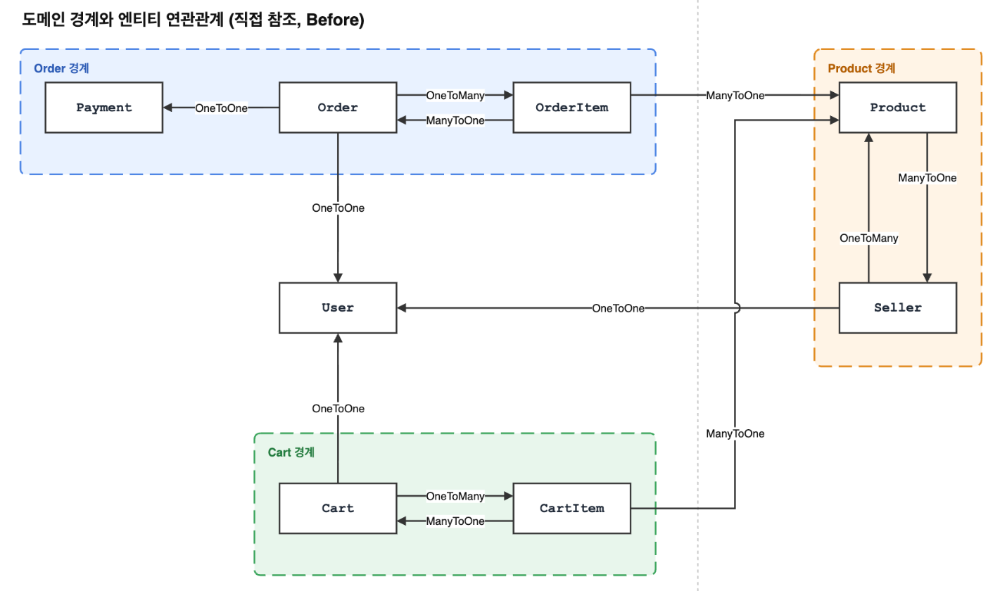

# 📓 과제 노트 (기록 · 질문)

**목차**

1. [질문](#질문)
2. [도메인 경계 다이어그램](#도메인-경계-다이어그램)
3. [수정 사항](#수정-사항)

> 과제([README.md](README.md))를 하면서 남기는 기록입니다. 질문은 수업 때 물어보고, 답을 들으면 항목 아래에 메모로 적어 둡니다.

## 질문

- [ ] **Seller 를 User 와 따로 둔 이유는?**
- [ ] **Seller 에 getter 로 `getId()` 가 없었던 이유는?**
- [ ] **폴더(패키지)별로 나뉜 도메인을 바운디드 컨텍스트로 볼 수 있나요?**

## 도메인 경계 다이어그램

**도메인 경계와 엔티티 연관관계 (직접 참조, Before)**



## 수정 사항

(2026-11-19, 커밋 `9fde97a`)

**1. 객체 참조 → ID 참조** — 다른 도메인 Entity 를 들던 필드를 `Long` ID 로 교체

```diff
 // Order.java (나머지도 같은 패턴)
-@OneToOne(fetch = FetchType.LAZY)
-@JoinColumn(name = "payment_id")
-private Payment payment;
+@Column(name = "payment_id")
+private Long paymentId;
```

| 엔티티 | Before | After |
|---|---|---|
| Cart | `User user` | `Long userId` |
| CartItem | `Product product` | `Long productId` |
| Order | `User user`, `Payment payment` | `Long userId`, `Long paymentId` |
| OrderItem | `Product product` | `Long productId` |
| Product | `Seller seller` | `Long sellerId` |
| Seller | `User user` | `Long userId` |

DB 컬럼명(`user_id`, `payment_id` 등)은 그대로입니다.

**2. 양방향 참조 제거** — ID 는 `Product.sellerId` 쪽만 보유

```diff
 // Seller.java
-@OneToMany(mappedBy = "seller")
-private List<Product> products = new ArrayList<>();
```

**3. 주문 당시 상품명·가격 스냅샷**

```diff
 // OrderItem.java
+@Column(nullable = false)
+private String productName;
+@Column(nullable = false)
+private BigDecimal unitPrice;

-public static OrderItem create(Product product, int quantity)
+public static OrderItem create(Long productId, String productName, BigDecimal unitPrice, int quantity)

 // OrderService.java
-OrderItem.create(product, quantity);
+OrderItem.create(product.getId(), product.getName(), product.getPrice(), quantity);
```

**4. 호출부 수정**

```diff
 // OrderService.java
-Order order = Order.create(user, orderItems);
+Order order = Order.create(user.getId(), orderItems);
-order.assignPayment(payment);
+order.assignPayment(payment.getId());

 // Seller.java — seller.getId() 가 필요해져서 추가
+@Getter
```

`DataInitializer`, `OrderRepositoryTests` 도 같은 방식으로 수정했습니다.

**검증**: `DomainBoundaryTest` 통과, `./gradlew test` 전체 통과, `bootRun` 후 `POST /orders` → `{"id":1}`
